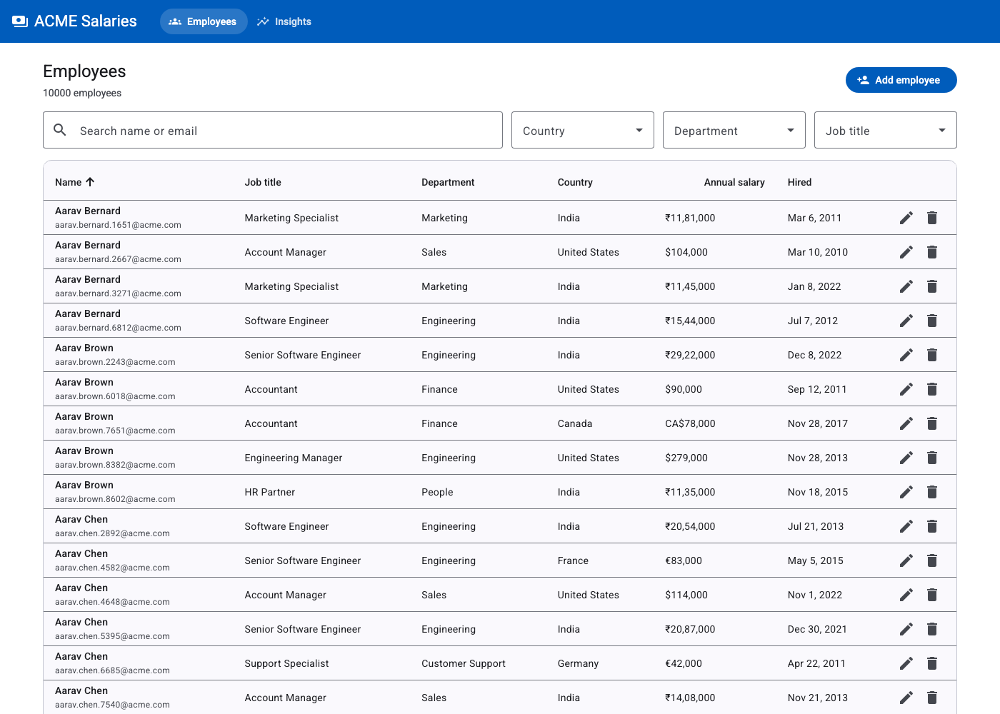
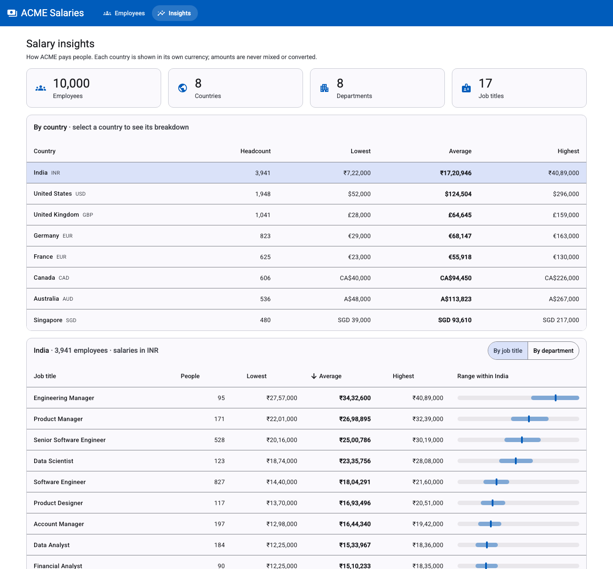

# ACME Salary Management

A web app for ACME's **HR Manager** to manage salary records for 10,000 employees across 8
countries, and to answer *"how do we pay people?"*. It replaces a set of Excel files.

**Stack:** Java 21 · Spring Boot 3.5 · SQLite + Flyway · Angular 20 · Angular Material · JUnit 5 / Jasmine

| Employee directory | Salary insights |
|---|---|
|  |  |

## What it does

- **Employee directory:** search by name or email, filter by country / department / job title, sort
  any column, with server-side paging over 10k rows.
- **Add, edit and delete** employees, with validation on the server and in the UI. A duplicate email
  is caught and shown on the field.
- **Salary insights:** org KPIs; headcount and min / average / max salary per country; and for each
  country, a breakdown by job title or department with a range bar.
  Salaries are always shown **in the country's own currency**. Nothing is mixed or converted
  (see the [requirements](docs/01-requirements.md) for why).
- **Seed:** 10,000 realistic, deterministic employees (the same data every time).

## Read these first

| Doc | What's in it |
|---|---|
| [01-requirements.md](docs/01-requirements.md) | One-page requirements: goal, scope, what's left out and why, assumptions |
| [02-plan.md](docs/02-plan.md) | Plan, architecture, design decisions, trade-offs, measured performance |
| [03-ai-workflow.md](docs/03-ai-workflow.md) | How AI was used, example prompts, what it got wrong and how that was caught |
| [04-demo-script.md](docs/04-demo-script.md) | Walkthrough used for the demo video |

## Run it

### Option A: Docker (one command)

```bash
docker build -t acme-salary .
docker run -p 8080:8080 -v acme-data:/data acme-salary
# open http://localhost:8080 (10,000 employees are seeded on first start)
```

### Option B: Local development

Requires **JDK 21+** (make sure `JAVA_HOME` points to it) and **Node 20+**.

```bash
# Terminal 1: API on :8080 (creates backend/salary.db and seeds it on first start)
cd backend && ./mvnw spring-boot:run

# Terminal 2: UI on :4200 (proxies /api to :8080)
cd frontend && npm install && npm start
# open http://localhost:4200
```

### Re-seed the database

```bash
scripts/seed.sh          # wipe and seed 10,000 employees
scripts/seed.sh 50000    # or any other size, e.g. for performance checks
```

| Env var | Default | Meaning |
|---|---|---|
| `DB_PATH` | `./salary.db` (`/data/salary.db` in Docker) | SQLite file |
| `SEED_EMPLOYEE_COUNT` | `10000` | Employees seeded on startup if the table is empty (`0` = off) |
| `PORT` | `8080` | HTTP port |

## Tests

```bash
cd backend && ./mvnw test          # 52 tests: unit, MVC slice, repository on real SQLite, seed
cd frontend && npm run test:ci     # 22 tests: API params, form, filtering, insights (headless Chrome)
```

All tests are fast (each suite runs in seconds) and deterministic: the seed is fixed and the
in-memory databases are isolated per test. CI runs both suites and the Docker build on every push
([.github/workflows/ci.yml](.github/workflows/ci.yml)).

## API

| Method | Path | Notes |
|---|---|---|
| `GET` | `/api/employees?search=&country=&department=&jobTitle=&page=&size=&sort=field,dir` | Paged, max size 100 |
| `GET` | `/api/employees/{id}` | |
| `POST` | `/api/employees` | 201 + `Location`; 400 with field `errors`; 409 on duplicate email |
| `PUT` | `/api/employees/{id}` | |
| `DELETE` | `/api/employees/{id}` | 204 |
| `GET` | `/api/meta` | Countries (with currency), departments, job titles |
| `GET` | `/api/insights/overview` | KPIs and per-country stats |
| `GET` | `/api/insights/countries/{code}` | Stats by job title and by department |

## Project layout

```
backend/    Spring Boot API, packaged by feature: employee/ insights/ seed/ common/
frontend/   Angular app: core/ (API + models), employees/, insights/, shared/
docs/       requirements, plan, AI workflow, demo script
scripts/    seed.sh
Dockerfile  one image: Angular build served by Spring Boot
render.yaml one-click deploy to Render
```

## Deploy

The repo includes a [Render blueprint](render.yaml): *New → Blueprint →* select this repo. On the
free plan the SQLite file is ephemeral, and it is re-seeded with the same 10,000 employees on each
restart. Attach a disk at `/data` to keep changes. Any Docker host works the same way.

## What's next

In priority order, with the reasoning in the [requirements](docs/01-requirements.md):
1. Authentication (SSO) and an audit trail of salary changes
2. CSV / Excel import and export, to migrate off the spreadsheets
3. Salary history per employee
4. Median and percentile bands; optional reporting currency with dated FX rates
